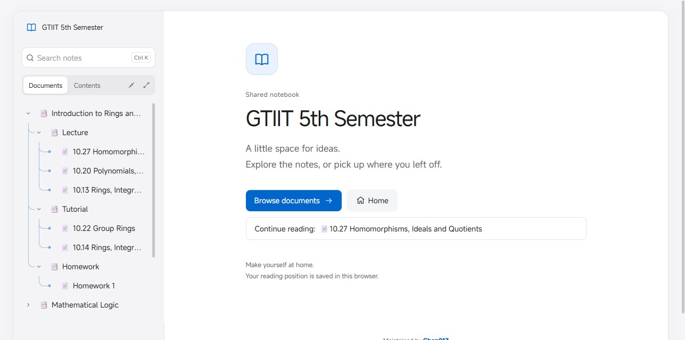
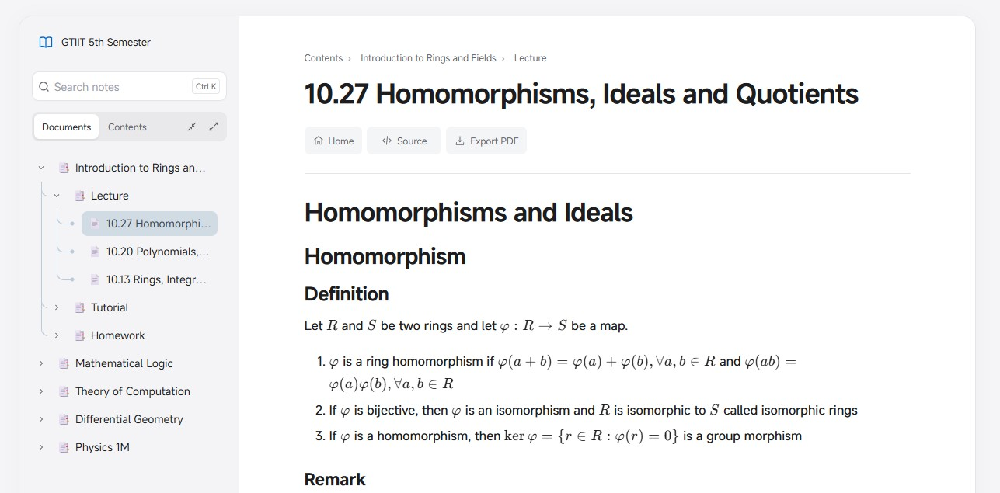
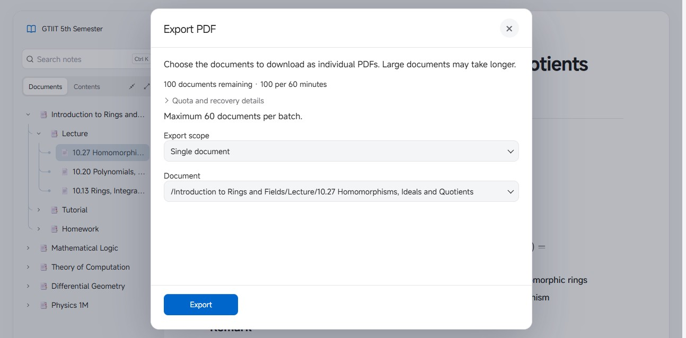

# Note

[English](README.md) | [简体中文](README_zh_CN.md)

A personal home for notes, built around the way I read and share my [SiYuan](https://b3log.org/siyuan/) workspace. Note brings notebooks, mathematics and diagrams to the web with a calm reading interface, considered motion and a lightweight, administrator-only backend.

[**📖 Visit Note**](https://note.etalib.space) · [**📚 Explore a notebook**](https://note.etalib.space/s/9898f37d) · [**⬇️ Releases**](https://github.com/Chen017/siyuan-plugin-share/releases)



## ✨ The experience

**A quieter place to read.** Soft neutral surfaces, blue accents, generous spacing and a clear typographic hierarchy give notes room to breathe. Light and dark themes share the same visual language; the interface adapts to smaller screens without losing the character of the desktop reader.

**Move through a notebook naturally.** The document tree keeps the shape of a SiYuan notebook, with aligned branches, expand and collapse controls, search, and a separate table of contents. Resize or hide the desktop sidebar and bring it back with Navigation; your preference is remembered. The notebook landing page offers **Browse documents** and a local **Continue reading** shortcut. Subtle course colors and pinned group headings help larger trees stay readable; mobile contents wrap long titles.



**Motion that stays out of the way.** Short transitions connect document changes and controls; slow navigation gets a progress indicator while fast requests avoid a distracting flash. Home, Source and Export PDF are within reach above each document, with a back-to-top control for longer pages. Switch between Source and Preview without losing your place. Footnotes open on a brief hover and can be pinned for longer reading. Reduced-motion preferences are respected.

**Made for the contents of a real notebook.** Markdown headings retain six distinct levels, with support for mathematics, code, tables, footnotes and diagrams. Mermaid and other diagram engines load when needed. SVG images can be displayed as images while active content is isolated. The reader also includes image viewing and downloads. Image previews support keyboard navigation and return focus when closed, while formulas retain a mathematical representation for assistive technology.

**Take notes with you.** Export one document, its descendants, selected documents or a whole share as separate PDFs. The exported text can be selected, searched and copied. A desktop dialog brings scope selection and visitor quota information together; limits are configurable. Filter selected documents, keep track of the count, and confirm before cancelling an active export. Mobile options keep the main action within reach; completed downloads remain available.



**Share from SiYuan, manage in one place.** Create links for individual documents, document trees or notebooks; update them incrementally while keeping their URLs. Passwords and expiration dates are optional. The personal admin dashboard brings share cards, access settings, recoverable deletion, site appearance and PDF settings together. Deleted shares offer a nearby Undo, and edited forms prompt before unsaved changes are discarded. This plugin is intentionally fixed to **note.etalib.space** and uses an administrator API key.

**A smaller, carefully maintained foundation.** The backend runs on PHP 8.3 with SQLite and Nginx. Public registration, ordinary-user management and unused upstream services have been removed for a single administrator. Locally served assets, on-demand diagram loading, automated browser and container regression tests, and GitHub Actions deployment support day-to-day maintenance.

## 🙏 Acknowledgements

Note began with [siyuan-plugin-share](https://github.com/b8l8u8e8/siyuan-plugin-share). Thank you to b8l8u8e8 and the contributors for the original sharing and synchronization foundation. The reader, visual design, interactions and personal administration have since been extensively reworked and are independently maintained here. The original copyright and [MIT license](LICENSE) are retained.

---

## 📝 Connect, deploy & maintain

### Connect SiYuan

1. Download `package.zip` from [Releases](https://github.com/Chen017/siyuan-plugin-share/releases) and install the plugin in SiYuan.
2. In the plugin settings, enter an administrator API key generated by the Note backend. The destination is fixed to `https://note.etalib.space`; the interface does not offer site switching.
3. Right-click a document or notebook to share it, set a password or expiration if needed, and copy the link.

Automatic updates and incremental synchronization preserve existing share links. On upgrade, the matching site's saved API key and sync state are retained; other saved site configurations are removed.

SiYuan 3.3.0 and later can preserve manually adjusted image sizes in new and re-synchronized shares, within the available screen width. Update the plugin and re-synchronize an existing share to bring across its sizes.

### Run the server

Docker Engine and Docker Compose are required. The server can be self-hosted, but the supplied plugin remains bound to the personal site above.

```sh
git clone https://github.com/Chen017/siyuan-plugin-share.git
cd siyuan-plugin-share
test -e php-site/config.php || cp php-site/config.example.php php-site/config.php
docker compose build --pull
bash scripts/prepare-config.sh siyuan-share-web:latest
docker compose up -d --no-build --pull never
docker compose ps
```

The supplied Compose configuration listens on `127.0.0.1:8081`; point an HTTPS reverse proxy at it and preserve the Host header. Configure the public URL in **Site settings**. On a fresh installation, find `SIYUAN_INITIAL_ADMIN_PASSWORD` in `docker compose logs web`, sign in as **admin**, and change the password before using the backend. Keep the logs private.

The hosted [Note dashboard](https://note.etalib.space/login) uses GitHub sign-in bound to one administrator account; password login is disabled for that instance. The project retains password login for fresh installations. GitHub sign-in requires an OAuth App and private server configuration for each instance; see the [maintenance guide](docs/MAINTENANCE.md#github-管理员登录). Never commit the Client Secret or include it in an image.

The SiYuan plugin connection key is separate from dashboard sign-in and permits access to the synchronization API; protect it like a password. Passwords set on individual shared documents are also independent of dashboard authentication.

Preserve `php-site/storage/`, `php-site/uploads/` and `php-site/config.php` when updating. Existing administrator passwords and API keys are not reset. To create an optional verified manual backup, run `bash backup-volumes.sh siyuan-share-web "$PWD/backups"`; keep the resulting directory and its `VERIFIED` marker private. Retain the previous backup if verification fails. After a successful verification, manually remove older backups if following the single-backup retention policy; the script does not remove them automatically. See the [maintenance guide](docs/MAINTENANCE.md) and [upload and migration safeguards](docs/UPLOAD_SAFETY.md).

The private GitHub OAuth configuration lives outside the project directory and is not included by that backup script. Store it separately and securely, and verify the authentication mode and read-only mount after restoring.

### Develop & verify

The plugin has no build step; the server and reader live in `php-site/`. The [maintenance guide](docs/MAINTENANCE.md) describes the project structure, development dependencies, test commands, CI/CD, releases and troubleshooting. See the [PDF guide](docs/GUEST_PDF_EXPORT.md) for export behavior and limits, and the [UI notes](docs/UI_REFINEMENT.md) for interaction and accessibility decisions.

GitHub Actions runs regression checks before deploying `main`. After a successful deployment, plugin changes are compared with the latest release and published automatically when needed. Release packages exclude instance configuration and runtime data.
