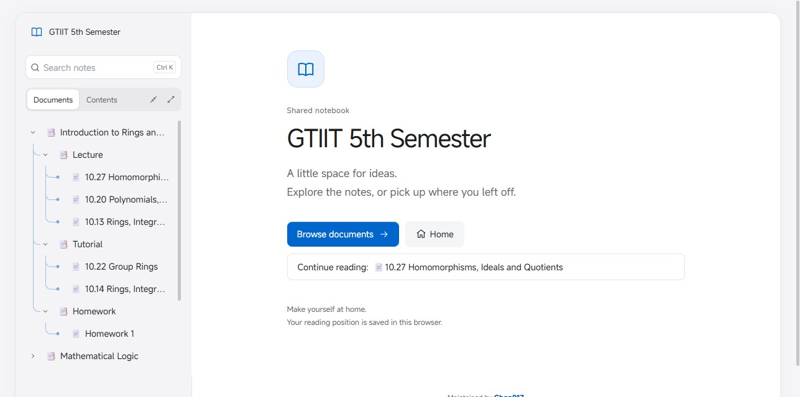
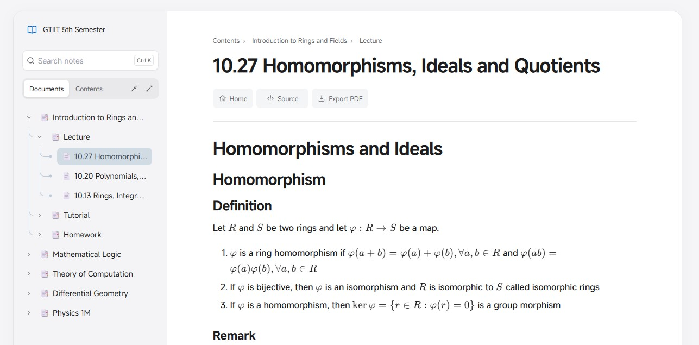
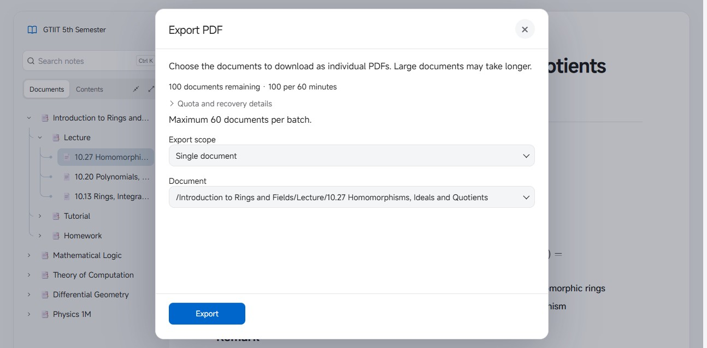

# Note

[简体中文](README_zh_CN.md) | [English](README.md)

一个围绕个人阅读与分享习惯打造的笔记空间。Note 将 [思源笔记](https://b3log.org/siyuan/)中的笔记本、数学公式和图表带到网页上，用安静的阅读界面、克制的动效和精简的单管理员后台，连接写作与阅读。

[**📖 访问 Note**](https://note.etalib.space) · [**📚 浏览笔记本**](https://note.etalib.space/s/9898f37d) · [**⬇️ 下载 Release**](https://github.com/Chen017/siyuan-plugin-share/releases)



## ✨ 阅读体验

**给内容留一点空间。** 柔和的中性色、清晰的蓝色操作色、宽松留白与分明的标题层级，让长篇笔记读起来更从容。明暗主题使用一致的视觉语言；界面也会适应小屏幕，延续桌面端的阅读气质。

**沿着文档树探索。** 侧栏保留思源笔记的层级，配有对齐的分支连接线、全部展开／收起、搜索和独立的文章目录。桌面侧栏支持拖动调宽、收起和通过 Navigation 按钮恢复，并记住上次状态。笔记本首页提供 **Browse documents** 和本地 **Continue reading** 入口，方便继续上次的阅读。低饱和课程配色与吸顶分组帮助梳理较长的文档树，手机目录也能完整换行显示长标题。



**让动效服务于阅读。** 文档切换与控件反馈使用简短过渡；较慢的请求会显示进度，快速切换则不闪烁加载条。文档上方提供 Home、Source 和 Export PDF 按钮，长页面也有返回顶部入口。Source / Preview 切换保留阅读位置。脚注在短暂停留后预览，也可以固定下来细读；界面尊重系统的减少动态效果设置。

**为真实的笔记内容排版。** Markdown 六级标题保持清晰层次，支持数学公式、代码、表格、脚注和图表。Mermaid 等图表引擎按需加载；SVG 保留图片展示，同时隔离主动内容。阅读器也提供图片查看与下载。图片预览支持键盘操作，关闭后回到原来的焦点；公式保留可供辅助技术读取的数学表达。

**把笔记带走。** 可按单篇、文档及子文档、手动选择或整个分享导出，每篇分别生成 PDF；正文支持选择、搜索和复制。桌面端导出弹窗集中呈现范围选择与访客额度，限制可在后台调整。手动选择支持筛选与数量提示，运行中关闭会先确认取消；手机上主要操作保持可见，已完成的下载继续保留。



**在思源中分享，在一个地方管理。** 单篇文档、文档树或整个笔记本都可以生成链接；增量同步更新内容时保留原链接，并可按需设置密码和有效期。个人后台将分享卡片、访问设置、可恢复删除、站点外观和 PDF 设置放在一起。删除后可就近撤销，已有编辑的表单在放弃未保存内容前提供提醒。插件固定连接 **note.etalib.space**，使用管理员 API key。

**精简而认真维护。** 后端使用 PHP 8.3、SQLite 和 Nginx，围绕单管理员场景移除了公开注册、普通用户管理及不再需要的上游服务。本地资源、按需加载图表、真实浏览器与容器回归测试，以及 GitHub Actions 自动部署，共同支持日常维护。

## 🙏 致谢

Note 最初基于 [siyuan-plugin-share](https://github.com/b8l8u8e8/siyuan-plugin-share) 建立。感谢 b8l8u8e8 和所有贡献者提供的分享与同步基础。此后，阅读器、视觉设计、交互和个人后台经过持续重做与独立维护，同时保留原作者版权及 [MIT 许可证](LICENSE)。

---

## 📝 连接、部署与维护

### 连接思源笔记

1. 从 [Releases](https://github.com/Chen017/siyuan-plugin-share/releases) 下载 `package.zip`，安装到思源笔记。
2. 在插件设置中填写 Note 后台生成的管理员 API key。插件固定连接 `https://note.etalib.space`，界面不提供站点切换。
3. 右键文档或笔记本创建分享，按需设置密码和有效期，然后复制链接。

自动更新与增量同步会保留已有分享链接。升级时会保留匹配该站点的 API key 和同步状态，移除其他站点配置。

思源 3.3.0 及以上版本新建分享或重新同步时，可以保留手动调整的图片尺寸，并适配屏幕可用宽度。更新插件后重新同步已有分享，即可带入图片尺寸。

### 运行服务端

需要 Docker Engine 和 Docker Compose。服务端可以自行部署；但随仓库提供的插件仍固定连接上述个人站点。

```sh
git clone https://github.com/Chen017/siyuan-plugin-share.git
cd siyuan-plugin-share
test -e php-site/config.php || cp php-site/config.example.php php-site/config.php
docker compose build --pull
bash scripts/prepare-config.sh siyuan-share-web:latest
docker compose up -d --no-build --pull never
docker compose ps
```

默认 Compose 监听 `127.0.0.1:8081`；将 HTTPS 反向代理指向该地址并保留 Host 请求头，在后台 **Site settings** 中配置公网地址。全新安装时，在 `docker compose logs web` 中查找 `SIYUAN_INITIAL_ADMIN_PASSWORD`，以 **admin** 登录并先修改密码。日志包含初始凭据，请妥善保护。

更新时保留 `php-site/storage/`、`php-site/uploads/` 和 `php-site/config.php`；已有管理员密码及 API key 不会被重置。需要手动创建经过校验的备份时，可运行 `bash backup-volumes.sh siyuan-share-web "$PWD/backups"`，并妥善保管生成目录及 `VERIFIED` 标记；新备份验证失败时应保留旧备份。若遵循只保留最新一份的策略，在新备份验证成功后手动删除旧备份；脚本不会自动清理。详见[维护指南](docs/MAINTENANCE.md)及[上传与迁移保护](docs/UPLOAD_SAFETY.md)。

### 开发与验证

思源插件无需构建；服务端和阅读器位于 `php-site/`。[维护指南](docs/MAINTENANCE.md)记录了项目结构、开发依赖、测试命令、CI/CD、发布与故障排查；[PDF 指南](docs/GUEST_PDF_EXPORT.md)说明导出行为和限制，[界面记录](docs/UI_REFINEMENT.md)记录交互与无障碍设计。

GitHub Actions 在 `main` 部署前运行回归检查。部署成功后，若插件相对最新 Release 有变化，将自动构建并发布新版本。发布包不包含实例配置和运行数据。
